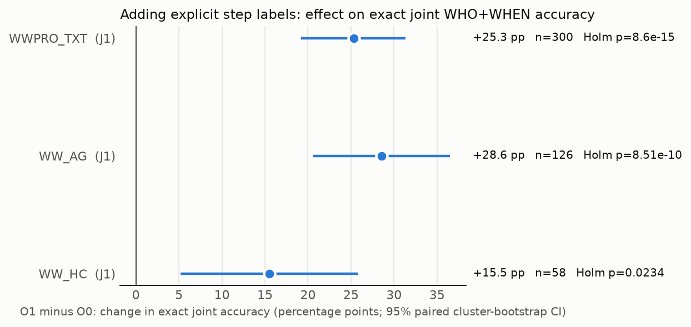
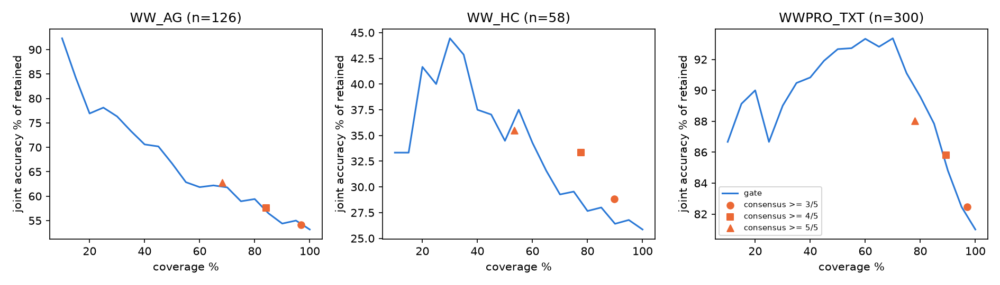
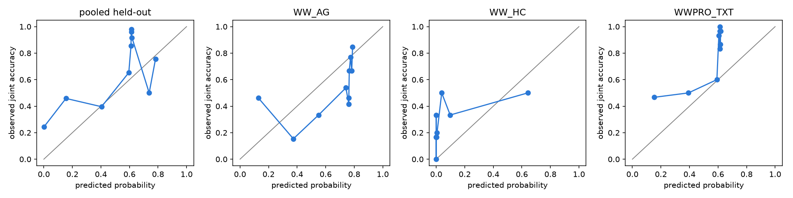

# IJIM report: step labels and a repetition gate for failure attribution

Two cross-dataset experiments with one frozen judge (`gpt-5.6-luna`, reasoning effort high). Experiment 1 asks whether adding explicit step labels to the judge input changes failure-attribution accuracy. Experiment 2 asks whether five repeated diagnoses can be turned into an accept-or-escalate signal. All numbers below are read from the files in `ijim/outputs/`; all responses shown are verbatim from `ijim/raw/calls.jsonl`.

## 1. Summary

- **Experiment 1.** Adding `[Step k]` labels (O1 vs O0) raised exact joint WHO+WHEN accuracy by **+28.6 pp** on Who&When Algorithm-Generated (n=126), **+15.5 pp** on Hand-Crafted (n=58) and **+25.3 pp** on the Who&When Pro text sample (n=300); all three are significant after Holm correction. The gain is almost entirely in the step, not the agent. Anonymising agent names (O1-A) and adding a role field (O2) changed nothing reliably.
- **Experiment 2.** Five repeats by the same judge are usually identical, so agreement is only a weak reliability signal. A seven-feature logistic gate trained on the other datasets ranks held-out cases better than chance (AUROC 0.67 to 0.78) and lifts accuracy among retained cases, but it does not clearly beat simple consensus rules, and unanimous agreement is still wrong for 37% (AG) and 64% (HC) of cases.
- **Cost.** 3,998 judge calls, about $8.3 in total. No API errors, no truncation.

## 2. Design

**Datasets.** `WW_AG` (Who&When Algorithm-Generated, 126 natural failures), `WW_HC` (Hand-Crafted, 58 natural failures), `WWPRO_TXT` (Who&When Pro, text modality, 300 sampled rows with injected errors). Pro rows were kept only if the error agent is non-null and the label maps to a single stored event (frameworks magentic-one, macnet, mathchat, metagpt; debate/dylan label whole rounds and were dropped). Stratified sample by framework, seed 20261022. Step labels are 0-based and index the event list directly (the labelled agent speaks at the labelled event in 123/126 AG, 56/58 HC and 100% of kept Pro rows).

**Judge prompt.** One user message, no system prompt, the paper's all-at-once prompt (identical text in every condition): *identify which agent made an error, at which step, and why; answer as `Agent Name:`, `Step Number:`, `Reason for Mistake:`*. W&W prompts include the stored final answer; Pro prompts omit it (stored for only 90% of sampled rows). No label (true agent, step, reason, Pro `ground_truth`, mode, level) ever enters a prompt; a unit test checks every real prompt.

**Trace conditions** (only the conversation log changes):

| Condition | Log format |
|---|---|
| O0 | original: one `Speaker: content` line per event |
| O1 | O0 plus a `[Step k]` line before each event, k in the dataset's native 0-based coordinate; event content byte-identical |
| O1-A | O1 with agent names replaced by `Agent A, B, …` (speaker and whole-word mentions in content); predicted aliases are mapped back before scoring |
| O2 | O1 plus a `(role=…)` line per event; only WW_AG has such a native field |

**Scoring.** Parser: first `Agent Name:` and first `Step Number:` line; step must be a plain integer; truncated or malformed output is a parse failure, counted as incorrect and never repaired. Agent correct by the original `evaluate.py` rule (labelled name contained in the first word-token of the prediction); step correct if equal to the label; joint = both. Normalized step error = |pred − true| / max(L − 1, 1).

**Statistics.** Primary endpoint exact joint accuracy; comparisons within each dataset, paired by trajectory (never pooled). Paired cluster bootstrap (B = 10,000, clusters = identical question text) for 95% CIs, exact McNemar test, Holm correction over the comparisons in each dataset. Wilson intervals for accuracies.

**Experiment 2.** O1 only, five fresh calls per trajectory (replicates 1 to 5). Seven label-free features (`joint_modal_agreement`, `agent_agreement`, `step_agreement`, `unique_pair_count`, `norm_step_spread`, `traj_length`, `parse_failure_count`). Candidate = most frequent complete (agent, step) pair (ties go to the earliest run); target = candidate exactly correct. Gate = L2 logistic regression (C = 1, standardised, equal total weight per training dataset), leave-one-dataset-out.

## 3. Experiment 1 results

### 3.1 Accuracy by condition

| Dataset | Trace condition | n | n_parseable | Agent % | Step % | Joint % | Joint Wilson lo | Joint Wilson hi | Median normalized error | parse_fail % |
|---|---|---|---|---|---|---|---|---|---|---|
| WWPRO_TXT | O0 | 300 | 293 | 80.0 | 56.0 | 54.3 | 48.7 | 59.9 | 0.000 | 2.3 |
| WWPRO_TXT | O1 | 300 | 294 | 81.0 | 79.7 | 79.7 | 74.8 | 83.8 | 0.000 | 2.0 |
| WWPRO_TXT | O1-A | 300 | 283 | 81.0 | 78.7 | 78.7 | 73.7 | 82.9 | 0.000 | 5.7 |
| WW_AG | O0 | 126 | 125 | 65.1 | 27.0 | 24.6 | 17.9 | 32.8 | 0.143 | 0.8 |
| WW_AG | O1 | 126 | 126 | 68.3 | 54.0 | 53.2 | 44.5 | 61.7 | 0.000 | 0.0 |
| WW_AG | O1-A | 126 | 125 | 64.3 | 50.8 | 50.0 | 41.4 | 58.6 | 0.000 | 0.8 |
| WW_AG | O2 | 126 | 126 | 69.0 | 57.1 | 56.3 | 47.6 | 64.7 | 0.000 | 0.0 |
| WW_HC | O0 | 58 | 52 | 41.4 | 12.1 | 10.3 | 4.8 | 20.8 | 0.136 | 10.3 |
| WW_HC | O1 | 58 | 56 | 48.3 | 31.0 | 25.9 | 16.3 | 38.4 | 0.114 | 3.4 |
| WW_HC | O1-A | 58 | 58 | 50.0 | 29.3 | 27.6 | 17.8 | 40.2 | 0.199 | 0.0 |

### 3.2 Primary effect: O1 vs O0 (exact joint accuracy)

| Dataset | Judge | Comparison | n | b | c | Delta joint (pp) | CI lo (pp) | CI hi (pp) | raw p | Holm p |
|---|---|---|---|---|---|---|---|---|---|---|
| WWPRO_TXT | J1 | O1 vs O0 | 300 | 89 | 13 | +25.3 | 19.2 | 31.3 | 4.3e-15 | 8.6e-15 |
| WW_AG | J1 | O1 vs O0 | 126 | 37 | 1 | +28.6 | 20.6 | 36.5 | 2.8e-10 | 8.5e-10 |
| WW_HC | J1 | O1 vs O0 | 58 | 10 | 1 | +15.5 | 5.2 | 25.9 | 0.012 | 0.023 |

`b` = trajectories wrong under O0 and right under O1, `c` = the reverse. The imbalance is large everywhere (e.g. AG 37 vs 1).



### 3.3 Secondary comparisons (joint accuracy)

| Dataset | Judge | Comparison | n | b | c | Delta joint (pp) | CI lo (pp) | CI hi (pp) | raw p | Holm p |
|---|---|---|---|---|---|---|---|---|---|---|
| WWPRO_TXT | J1 | O1-A vs O1 | 300 | 17 | 20 | -1.0 | -5.4 | 3.6 | 0.74 | 0.74 |
| WW_AG | J1 | O1-A vs O1 | 126 | 7 | 11 | -3.2 | -9.5 | 3.2 | 0.48 | 0.58 |
| WW_AG | J1 | O2 vs O1 | 126 | 6 | 2 | +3.2 | -0.8 | 7.9 | 0.29 | 0.58 |
| WW_HC | J1 | O1-A vs O1 | 58 | 3 | 2 | +1.7 | -5.2 | 8.6 | 1 | 1 |

### 3.4 Where the O1 gain comes from (paired change, O1 vs O0)

| Dataset | Metric | n | Delta (pp) | CI lo (pp) | CI hi (pp) |
|---|---|---|---|---|---|
| WWPRO_TXT | agent | 300 | +1.0 | -3.0 | 4.7 |
| WWPRO_TXT | step | 300 | +23.7 | 17.5 | 29.7 |
| WWPRO_TXT | parse_fail | 300 | -0.3 | -2.3 | 1.6 |
| WW_AG | agent | 126 | +3.2 | -2.4 | 8.7 |
| WW_AG | step | 126 | +27.0 | 18.3 | 35.7 |
| WW_AG | parse_fail | 126 | -0.8 | -2.4 | 0.0 |
| WW_HC | agent | 58 | +6.9 | -1.7 | 17.2 |
| WW_HC | step | 58 | +19.0 | 8.6 | 31.0 |
| WW_HC | parse_fail | 58 | -6.9 | -17.2 | 1.7 |

Step accuracy moves by 19 to 27 pp; agent accuracy by at most 7 pp with intervals that include zero. Step labels help the judge locate the step, not decide who erred. A plausible mechanism is that labels spare the judge from counting events in long traces, so this should be read as a step-localisation effect.

### 3.5 Interpretation

Adding explicit `[Step k]` labels to the same judge input (same prompt text, same event content, same judge, `gpt-5.6-luna` at high reasoning effort) changed exact joint WHO+WHEN accuracy by +28.6 pp on Who&When Algorithm-Generated (24.6% to 53.2%, n = 126, 95% CI 20.6 to 36.5, Holm p < 0.001), by +15.5 pp on Hand-Crafted (10.3% to 25.9%, n = 58, CI 5.2 to 25.9, Holm p = 0.023), and by +25.3 pp on the sampled Who&When Pro text set (54.3% to 79.7%, n = 300, CI 19.2 to 31.3, Holm p < 0.001). The gain comes almost entirely from the step: exact-step accuracy rose by 27.0, 19.0 and 23.7 pp respectively, while agent accuracy moved by at most 3 to 7 pp and its intervals include zero. Replacing agent names with anonymous aliases (O1-A vs O1) and adding the `role` field on Algorithm-Generated (O2 vs O1) produced no reliable change (all Holm p > 0.5). These results hold for these datasets and this one judge only; the labels may help partly by sparing the judge from counting events in long traces, so the finding concerns step localization, not diagnostic reasoning in general. Pro labels are injected errors with exact labels by construction, whereas Who&When failures are natural and the Hand-Crafted set is small (n = 58), so its interval is wide. Parse failures were low (0 to 3%) except O0 on Hand-Crafted (10.3%) and O1-A on Pro (5.7%); they are counted as incorrect and not repaired.

## 4. Experiment 2 results

### 4.1 Consistency of the five repeats

| dataset | n | ties | no_parseable_run | uniq=0 | uniq=1 | uniq=2 | uniq=3 | uniq=4 | uniq=5 | target_rate |
|---|---|---|---|---|---|---|---|---|---|---|
| WWPRO_TXT | 300 | 2 | 1 | 1 | 242 | 52 | 5 | 0 | 0 | 0.810 |
| WW_AG | 126 | 3 | 0 | 0 | 86 | 31 | 8 | 1 | 0 | 0.532 |
| WW_HC | 58 | 3 | 0 | 0 | 34 | 19 | 5 | 0 | 0 | 0.259 |

`uniq=k` counts trajectories whose five runs produced k distinct (agent, step) pairs. Most trajectories have one pair: the judge repeats itself, right or wrong.

### 4.2 Gate and baselines on each held-out dataset

| Held-out dataset | Method | Coverage % | Retained n | Joint % | Brier score | AUROC | 95% CI/note |
|---|---|---|---|---|---|---|---|
| WW_AG | Gate@100 | 100.0 | 126 | 53.2 | 0.255 | 0.701 | joint CI [0.444, 0.619]; Brier CI [0.213, 0.300]; AUROC CI [0.611, 0.787] |
| WW_AG | Gate@75 | 75.0 | 95 | 58.9 |  |  | joint CI [0.495, 0.695] |
| WW_AG | Gate@50 | 50.0 | 63 | 66.7 |  |  | joint CI [0.556, 0.794] |
| WW_AG | Gate@25 | 25.0 | 32 | 78.1 |  |  | joint CI [0.625, 0.906] |
| WW_AG | Accept-all | 100.0 | 126 | 53.2 | 0.285 |  | Brier uses training-datasets target rate 0.721 |
| WW_AG | Consensus>=3/5 | 96.8 | 122 | 54.1 |  | 0.635 (continuous joint_modal_agreement) |  |
| WW_AG | Consensus>=4/5 | 84.1 | 106 | 57.5 |  |  |  |
| WW_AG | Consensus=5/5 | 68.3 | 86 | 62.8 |  |  |  |
| WW_HC | Gate@100 | 100.0 | 58 | 25.9 | 0.235 | 0.671 | joint CI [0.155, 0.379]; Brier CI [0.138, 0.339]; AUROC CI [0.495, 0.828] |
| WW_HC | Gate@75 | 75.0 | 44 | 29.5 |  |  | joint CI [0.159, 0.432] |
| WW_HC | Gate@50 | 50.0 | 29 | 34.5 |  |  | joint CI [0.207, 0.552] |
| WW_HC | Gate@25 | 25.0 | 15 | 40.0 |  |  | joint CI [0.200, 0.667] |
| WW_HC | Accept-all | 100.0 | 58 | 25.9 | 0.412 |  | Brier uses training-datasets target rate 0.728 |
| WW_HC | Consensus>=3/5 | 89.7 | 52 | 28.8 |  | 0.674 (continuous joint_modal_agreement) |  |
| WW_HC | Consensus>=4/5 | 77.6 | 45 | 33.3 |  |  |  |
| WW_HC | Consensus=5/5 | 53.4 | 31 | 35.5 |  |  |  |
| WWPRO_TXT | Gate@100 | 100.0 | 300 | 81.0 | 0.202 | 0.781 | joint CI [0.761, 0.857]; Brier CI [0.185, 0.219]; AUROC CI [0.702, 0.856] |
| WWPRO_TXT | Gate@75 | 75.0 | 225 | 91.1 |  |  | joint CI [0.866, 0.951] |
| WWPRO_TXT | Gate@50 | 50.0 | 150 | 92.7 |  |  | joint CI [0.885, 0.973] |
| WWPRO_TXT | Gate@25 | 25.0 | 75 | 86.7 |  |  | joint CI [0.844, 0.986] |
| WWPRO_TXT | Accept-all | 100.0 | 300 | 81.0 | 0.287 |  | Brier uses training-datasets target rate 0.446 |
| WWPRO_TXT | Consensus>=3/5 | 97.0 | 291 | 82.5 |  | 0.691 (continuous joint_modal_agreement) |  |
| WWPRO_TXT | Consensus>=4/5 | 89.3 | 268 | 85.8 |  |  |  |
| WWPRO_TXT | Consensus=5/5 | 78.0 | 234 | 88.0 |  |  |  |

Retained cases are ranked by predicted probability (ties broken by row order, never by labels). Consensus rows are fixed thresholds with their own coverage. Accept-all Brier uses the training datasets' target rate as a constant. The gate was not tuned and no threshold was chosen on test data.





### 4.3 Sensitivity: W&W as a single fold

| Held-out dataset | Method | Coverage % | Retained n | Joint % | Brier score | AUROC |
|---|---|---|---|---|---|---|
| WW_all | Gate@100 | 100.0 | 184 | 44.6 | 0.230 | 0.739 |
| WW_all | Gate@50 | 50.0 | 92 | 63.0 |  |  |
| WW_all | Accept-all | 100.0 | 184 | 44.6 | 0.380 |  |
| WW_all | Consensus=5/5 | 63.6 | 117 | 55.6 |  |  |
| WWPRO_TXT | Gate@100 | 100.0 | 300 | 81.0 | 0.202 | 0.781 |
| WWPRO_TXT | Gate@50 | 50.0 | 150 | 92.7 |  |  |
| WWPRO_TXT | Accept-all | 100.0 | 300 | 81.0 | 0.287 |  |
| WWPRO_TXT | Consensus=5/5 | 78.0 | 234 | 88.0 |  |  |

With three datasets this fold trains on Pro alone (or on W&W alone), a weaker training set; treat it as a robustness check only.

### 4.4 Interpretation

Five repeated O1 diagnoses by the same judge were often identical (all five runs agreed on the full agent-step pair for 81% of Pro, 68% of Algorithm-Generated and 59% of Hand-Crafted trajectories), so agreement carries limited information. A seven-feature logistic gate trained on the other datasets ranked held-out trajectories better than chance (AUROC 0.70 on Algorithm-Generated, 0.67 on Hand-Crafted with a CI of 0.50 to 0.83, 0.78 on Pro) and raised accuracy among retained cases, for example from 53.2% to 78.1% on Algorithm-Generated when the top 25% is kept. Simple consensus rules performed about as well at their own coverage: unanimous agreement kept 68% of Algorithm-Generated cases at 62.8% joint accuracy, and the gate's curve does not clearly beat the consensus points on Hand-Crafted or Pro. Self-consistency is not proof of correctness: 37% of unanimous Algorithm-Generated diagnoses and 64% of unanimous Hand-Crafted diagnoses were still wrong, because the judge repeats the same mistake. On Pro the gate's accuracy is not monotone in coverage (91.1%, 92.7%, 86.7% at 75, 50, 25%), and the Brier comparison with accept-all is flattered by a constant trained on datasets with very different base rates. With three datasets each fold trains on only two, Hand-Crafted has 58 trajectories, and Pro errors are injected, so these results should be read as descriptive; no threshold is recommended.

## 5. One worked example of each test

All examples are real trajectories and verbatim model responses. Prompt excerpts show the first events of the failure log; the instruction text around the log is the same in every condition.

### 5.1 Conditions O0, O1, O1-A, O2 on one trajectory (`WW_AG`, `Algorithm-Generated/107`)

Problem: *The dog genome was first mapped in 2004 and has been updated several times since. What is the link to the files that were most relevant in May 2020?* Stored answer: `ftp://ftp.broadinstitute.org/distribution/assemblies/mammals/dog/canFam3.1/`. The trajectory has L = 8 events. **Ground truth** (never shown to the judge): agent `Verification_Expert`, step 6.

**O0: original log**

Log as sent to the judge for the events around the labelled step (event contents flattened to one line and clipped to 150 characters here; the judge saw them in full):

```
Computer_terminal: exitcode: 0 (execution succeeded) Code output: Search Result 1: Genome sequencing of 2000 canids by the Dog10K consortium advances the ... https://gen …[truncated]
Verification_Expert: # Verification of Results: Based on the search results obtained, the most relevant dog genome assemblies and related data files as of May 2020 include …[truncated]
```

Judge response (verbatim, clipped): 

```
Agent Name: Verification_Expert  
Step Number: 7  
Reason for Mistake: The verification agent incorrectly treated article and project webpages as links to the relevant genomic files and included assemblies or sources published after May 2020. It failed to identify the required Broad Institute FTP directory for the CanFam3.1 files: `ftp://ftp.broadinstitute.org/distribution/assemblies/mammals/dog/canFam3.1/`.
```

Scored: parsed agent `Verification_Expert`, step `7` → agent_ok = **True**, step_ok = **False**, joint_ok = **False**; normalized step error 0.143; 614 output tokens (516 reasoning).

**O1: with step labels**

Log as sent to the judge for the events around the labelled step (event contents flattened to one line and clipped to 150 characters here; the judge saw them in full):

```
[Step 5]
Computer_terminal: exitcode: 0 (execution succeeded) Code output: Search Result 1: Genome sequencing of 2000 canids by the Dog10K consortium advances the ... https://gen …[truncated]
[Step 6]
Verification_Expert: # Verification of Results: Based on the search results obtained, the most relevant dog genome assemblies and related data files as of May 2020 include …[truncated]
```

Judge response (verbatim, clipped): 

```
Agent Name: Verification_Expert  
Step Number: 6  
Reason for Mistake: The Verification_Expert incorrectly treated links to later journal articles and general webpages as the requested genomic data files. Several cited resources postdated May 2020, and the CanFam3.1 citation linked to a Nature article rather than the relevant Broad Institute FTP directory. The correct link should have been: `ftp://ftp.broadinstitute.org/distribution/assemblies/mammals/dog/canFam3.1/`.
```

Scored: parsed agent `Verification_Expert`, step `6` → agent_ok = **True**, step_ok = **True**, joint_ok = **True**; normalized step error 0.000; 627 output tokens (516 reasoning).

**O1-A: step labels and anonymous agents**

Log as sent to the judge for the events around the labelled step (event contents flattened to one line and clipped to 150 characters here; the judge saw them in full):

```
[Step 5]
Agent C: exitcode: 0 (execution succeeded) Code output: Search Result 1: Genome sequencing of 2000 canids by the Dog10K consortium advances the ... https://gen …[truncated]
[Step 6]
Agent D: # Verification of Results: Based on the search results obtained, the most relevant dog genome assemblies and related data files as of May 2020 include …[truncated]
```

Judge response (verbatim, clipped): 

```
Agent Name: Agent D  
Step Number: 6  
Reason for Mistake: Agent D incorrectly verified and reported later genome assemblies and general publication webpages as the files relevant in May 2020. It failed to identify the expected Broad Institute FTP directory for the then-relevant CanFam3.1 assembly: `ftp://ftp.broadinstitute.org/distribution/assemblies/mammals/dog/canFam3.1/`. Some cited resources were published after May 2020, so they could not accurately represent the relevant files at that time.
```

Scored: parsed agent `Agent D`, step `6` → agent_ok = **True**, step_ok = **True**, joint_ok = **True**; normalized step error 0.000; 635 output tokens (516 reasoning). Alias map used to score: `{'Agent A': 'Genomics_Expert', 'Agent B': 'Bioinformatics_Expert', 'Agent C': 'Computer_terminal', 'Agent D': 'Verification_Expert'}`.

**O2: step labels plus role**

Log as sent to the judge for the events around the labelled step (event contents flattened to one line and clipped to 150 characters here; the judge saw them in full):

```
[Step 5]
Computer_terminal: exitcode: 0 (execution succeeded) Code output: Search Result 1: Genome sequencing of 2000 canids by the Dog10K consortium advances the ... https://gen …[truncated]
(role=user)
[Step 6]
Verification_Expert: # Verification of Results: Based on the search results obtained, the most relevant dog genome assemblies and related data files as of May 2020 include …[truncated]
(role=user)
```

Judge response (verbatim, clipped): 

```
Agent Name: Verification_Expert  
Step Number: 6  
Reason for Mistake: The Verification_Expert incorrectly validated the search results and provided links to later publications or general webpages rather than the requested genomic files relevant in May 2020. It omitted the correct Broad Institute FTP directory for the CanFam3.1 assembly—`ftp://ftp.broadinstitute.org/distribution/assemblies/mammals/dog/canFam3.1/`—and falsely concluded that the supplied links were accurate and appropriately dated.
```

Scored: parsed agent `Verification_Expert`, step `6` → agent_ok = **True**, step_ok = **True**, joint_ok = **True**; normalized step error 0.000; 449 output tokens (336 reasoning).

Here O0 picked the right agent but named step 7 instead of 6; every labelled condition got step 6.

### 5.2 Pro text trajectory, O0 vs O1 (`simpleqa_verified_magentic-one_0444`, framework `magentic-one`)

Problem: *What certification did Reba's album "So Good Together" receive from the United States (RIAA)?

Provide a concise, factual answer. State your final answer on the last line, prefixed with "FINAL ANSWER: " (no extra commentary after).* (Pro prompt variant: answer not shown). L = 3. **Ground truth** (injected error, never shown): agent `orchestrator`, step 2, mode `V.2`.

**O0:** parsed `orchestrator`, step `3` → agent_ok = True, step_ok = False, joint_ok = **False**. Response (clipped):

```
Agent Name: orchestrator  
Step Number: 3  
Reason for Mistake: The orchestrator incorrectly changed the certification from Platinum to Gold based on an unsupported citation, despite the available evidence indicating the album was RIAA-certified Platinum.  
FINAL ANSWER: Platinum
```

**O1:** parsed `orchestrator`, step `2` → agent_ok = True, step_ok = True, joint_ok = **True**. Response (clipped):

```
Agent Name: orchestrator  
Step Number: 2  
Reason for Mistake: The orchestrator incorrectly reported Gold, contradicting the evidence in Step 1 indicating that “So Good Together” was certified Platinum by the RIAA.

FINAL ANSWER: Platinum
```

### 5.3 Parse-failure rule (`WW_HC`, `Hand-Crafted/56`, O0)

The parser accepts only a plain integer after `Step Number:`. This response is a parse failure (`bad_step`) and counts as wrong for agent, step and joint; it is not repaired or re-asked:

```
Agent Name: Orchestrator  
Step Number: 5 (zero-based; the sixth agent entry)  
Reason for Mistake: After WebSurfer’s initial search explicitly identified that the Macrotrends data was adjusted for stock splits and dividends, the Orchestrator still directed the search toward that data to answer an **unadjusted** price question. This conflated split-adjusted historical prices with nominal prices and reinforced the incorrect early-2000s estimate, ultimately producing the unsupported answer of 2007 …[truncated]
```

### 5.4 Statistical test worked through (`WW_HC`, O1 vs O0)

Of 58 paired trajectories, b = 10 were wrong under O0 and right under O1, c = 1 the reverse. Exact McNemar test: two-sided binomial test of min(b, c) = 1 out of b + c = 11 with p = 0.5, raw p = 0.0117. Paired change = +15.5 pp (O0 10.3% → O1 25.9%), bootstrap 95% CI [5.2, 25.9]. Holm adjustment over the 2 comparisons in this dataset (O1 vs O0, O1-A vs O1) gives p = 0.0234.

### 5.5 Experiment 2, split votes with a tie, resolved by the earliest run (`WW_AG`, `Algorithm-Generated/122`)

Ground truth (not used by the features): agent `BingAPI_Expert`, step 3, L = 10.

| replicate | parsed_agent | parsed_step | joint_ok |
|---|---|---|---|
| 1 | BingAPI_Expert | 0 | False |
| 2 | Accessibility_Expert | 7 | False |
| 3 | BingAPI_Expert | 0 | False |
| 4 | Accessibility_Expert | 1 | False |
| 5 | Accessibility_Expert | 1 | False |

Features: `joint_modal_agreement` = 0.4, `agent_agreement` = 0.6, `step_agreement` = 0.4, `unique_pair_count` = 3, `norm_step_spread` = 0.778, `traj_length` = 10, `parse_failure_count` = 0. Candidate tie occurred: True. **Target = 0** (candidate exactly correct on agent and step). Gate probability (model trained without this dataset): **0.064**.

### 5.6 Experiment 2, unanimous and correct (`WW_AG`, `Algorithm-Generated/9`)

Ground truth (not used by the features): agent `GameTheory_Expert`, step 1, L = 5.

| replicate | parsed_agent | parsed_step | joint_ok |
|---|---|---|---|
| 1 | GameTheory_Expert | 1 | True |
| 2 | GameTheory_Expert | 1 | True |
| 3 | GameTheory_Expert | 1 | True |
| 4 | GameTheory_Expert | 1 | True |
| 5 | GameTheory_Expert | 1 | True |

Features: `joint_modal_agreement` = 1, `agent_agreement` = 1, `step_agreement` = 1, `unique_pair_count` = 1, `norm_step_spread` = 0, `traj_length` = 5, `parse_failure_count` = 0. Candidate tie occurred: False. **Target = 1** (candidate exactly correct on agent and step). Gate probability (model trained without this dataset): **0.793**.

### 5.7 Experiment 2, unanimous but wrong (self-consistency is not correctness) (`WW_HC`, `Hand-Crafted/6`)

Ground truth (not used by the features): agent `Orchestrator`, step 5, L = 8.

| replicate | parsed_agent | parsed_step | joint_ok |
|---|---|---|---|
| 1 | WebSurfer | 4 | False |
| 2 | WebSurfer | 4 | False |
| 3 | WebSurfer | 4 | False |
| 4 | WebSurfer | 4 | False |
| 5 | WebSurfer | 4 | False |

Features: `joint_modal_agreement` = 1, `agent_agreement` = 1, `step_agreement` = 1, `unique_pair_count` = 1, `norm_step_spread` = 0, `traj_length` = 8, `parse_failure_count` = 0. Candidate tie occurred: False. **Target = 0** (candidate exactly correct on agent and step). Gate probability (model trained without this dataset): **0.704**.

## 6. Caveats

- One judge (`gpt-5.6-luna`, cost tier) and three datasets; nothing here generalises beyond them.
- Pro errors are injected with exact labels; W&W failures are natural and its labels are single-annotator step choices. Hand-Crafted has only 58 trajectories, so its intervals are wide.
- The O1 gain may partly reflect easier step counting rather than better diagnosis.
- The OpenAI Responses API has no seed parameter, so the five repeats are not seed-controlled.
- Exp 2 gate: each fold trains on only two datasets of different difficulty; Brier comparison with accept-all is flattered by a constant fitted on different base rates; consensus baselines have no bootstrap CIs; the gate does not clearly beat consensus on HC and Pro.
- Parse failures count as incorrect (0 to 3% in most cells; 10.3% for O0 on HC, 5.7% for O1-A on Pro).
- After the freeze only plot styling changed (`stats_exp1.py`, `gate_exp2.py`); no statistic changed. Earlier W&W/Pro runs were not reused.

## 7. Files and reproducibility

`config/protocol_freeze.md` (hashes), `raw/calls.jsonl` (every request and response), `outputs/exp1/` (`X1_predictions.csv`, `X1_results.csv`, `X1_effects*.csv`, `X1_forest.png`, interpretation), `outputs/exp2/` (`X2_runs.csv`, `X2_gate_table.csv`, `X2_gate_predictions.csv`, `X2_results*.csv`, `X2_counts.csv`, figures, interpretation), `outputs/X_manifest.md`, `outputs/examples/` (rendered prompts for every condition). Re-create tables with `python src/make_tables.py`, `src/stats_exp1.py`, `src/gate_exp2.py`, and this report with `src/make_report.py`.
